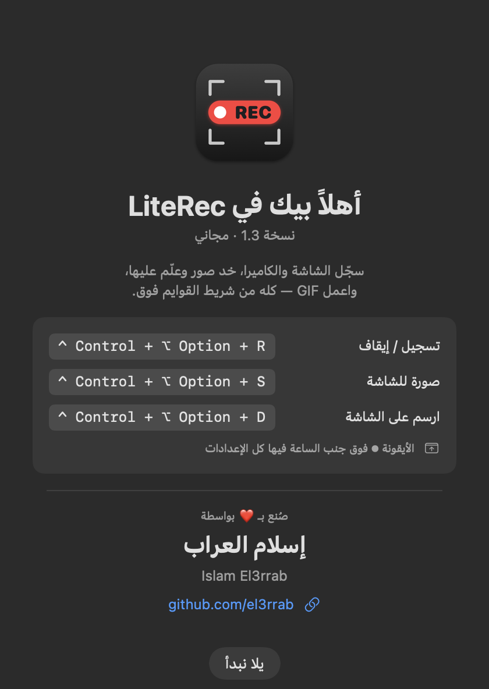

# LiteRec

**مسجّل شاشة وكاميرا وصور للماك — خفيف ومجاني**

سجّل الشاشة والكاميرا، خد صور وعلّم عليها، واعمل GIF — كله من شريط القوايم فوق.

### [⬇️ نزّل LiteRec (آخر نسخة)](https://github.com/el3rrab/literec-app/releases/latest/download/LiteRec.dmg)

macOS 15 أو أحدث · أي ماك (Apple Silicon أو Intel) · مجاني

---

## بيعمل إيه

- 🎥 **تسجيل الشاشة** — الشاشة كلها، أو جزء تحدده بالماوس، أو نافذة. مع صوت الجهاز والمايك.
- 📹 **تسجيل الكاميرا** — أي كاميرا USB (زي GoPro) أو كاميرا الماك، وتظهر فقاعة جوه فيديو الشاشة.
- ⏱ **عد تنازلي** قبل التسجيل، وعلامة **● REC** على الشاشة عشان تفتكر إنك بتسجل (مش بتظهر في الفيديو).
- ✏️ **ارسم على الشاشة وإنت بتسجل** — أسهم، مربعات، تظليل، أرقام.
- 📸 **صور للشاشة** — بتتنسخ على طول، ومحرر فيه أسهم وكتابة وتغبيش للحاجات السرية.
- ✂️ **قص الفيديو** من غير ما الجودة تقل، و🖼 **تحويل لـ GIF**.

## الاختصارات

| دوس مع بعض | بيعمل إيه |
|---|---|
| `⌃⌥R` — Control + Option + R | تسجيل / إيقاف |
| `⌃⌥S` — Control + Option + S | صورة للشاشة |
| `⌃⌥D` — Control + Option + D | ارسم على الشاشة |

> ⌃ = Control · ⌥ = Option · ⌘ = Command

## التثبيت

1. نزّل **LiteRec.dmg** من [الزرار اللي فوق](https://github.com/el3rrab/literec-app/releases/latest/download/LiteRec.dmg) وافتحه.
2. اسحب **LiteRec** على فولدر **Applications**.
3. افتحه من Applications. أول مرة الماك هيقول إنه مش قادر يتأكد من التطبيق (لأنه مش من الـ App Store):
   **System Settings ← Privacy & Security ← انزل لتحت ← Open Anyway**. ده بيحصل مرة واحدة بس.
4. التطبيق بيظهر كأيقونة ⏺ فوق في شريط القوايم جنب الساعة (مش في الـ Dock).
5. أول تسجيل: اسمح بإذن تسجيل الشاشة والمايك والكاميرا، وبعد إذن الشاشة دوس «اقفل وافتح تاني».

الملفات بتتحفظ في **Movies ← LiteRec**.

## كل النسخ

[صفحة النسخ](https://github.com/el3rrab/literec-app/releases)

---

صُنع بـ ❤️ بواسطة **إسلام العراب** · Islam El3rrab — [github.com/el3rrab](https://github.com/el3rrab)

