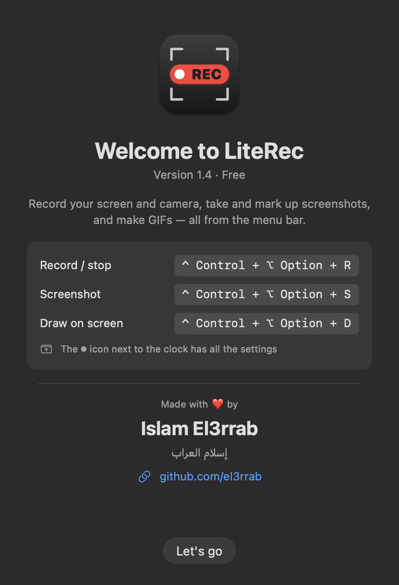

# LiteRec — Free Screen & Camera Recorder for Mac

**Record your screen and webcam, take annotated screenshots, draw on screen and make GIFs — free, lightweight, right from the macOS menu bar.**

### [⬇️ Download LiteRec for Mac (free)](https://github.com/el3rrab/literec-app/releases/latest/download/LiteRec.dmg)

### [📖 Interactive tour & guide](https://el3rrab.github.io/literec-app/)

macOS 15 Sequoia or later · Apple Silicon (M1/M2/M3/M4) & Intel · English & Arabic · No watermark · No account

---

## Why LiteRec?

LiteRec is a **free screen recorder for macOS** that lives in your menu bar. It records your **screen, webcam, system audio and microphone** together, so you can make tutorials, demos, bug reports and video messages in seconds — without heavy software, subscriptions or watermarks.

It's a lightweight, free alternative for the everyday things people use paid screen-capture tools for: **screen recording with a webcam bubble, screenshots with arrows and blur, drawing on screen while you explain, trimming, and GIFs.**

## Features

### 🎥 Screen recording
- Record the **full screen** (any display), a **region** you drag with the mouse, or a **single window**
- **System audio + microphone** at the same time, with a live mic level meter and a muted-mic warning
- **Countdown** (3 / 5 / 10 s) and a red frame around the recorded region (not visible in the video)
- Saves **MP4 (HEVC)** — small files, high quality, up to 60 fps

### 📹 Webcam / camera recording
- Works with the built-in FaceTime camera or **any USB camera, including a GoPro in webcam mode**
- A round **camera bubble** inside the screen recording — drag it anywhere
- The camera is also saved as its **own full-quality file**, with sound and picture in sync

### ⏺ Floating REC badge
- A small badge shows the time, what's being recorded and a stop button — **hidden from the recording**

### ✏️ Draw on screen while recording
- Arrows, boxes, pen, highlighter and numbered steps on top of any app — **visible in the video**
- Press <kbd>Esc</kbd> and it's gone

### 📸 Screenshots + editor
- Drag a region or **click a window** — the screenshot is **copied to the clipboard instantly**
- Built-in editor: arrows, boxes, pen, highlight, text, **numbered steps** and **blur / pixelate** for private info
- Optional auto-delete of old screenshots after 3 / 7 / 30 days

### ✂️ Trim, GIF & compress
- **Trim** the start and end without re-encoding (no quality loss)
- **Convert video to GIF** in one click
- **Compress** large recordings to 1080p or 720p

### 🧩 Made for everyday use
- **Menu bar app** with a floating panel you can move anywhere
- **English & Arabic** interface (switch in Settings)
- Recordings are never lost — even if the app is closed mid-recording

## Keyboard shortcuts

| Shortcut | Action |
|---|---|
| <kbd>⌃⌥R</kbd> (Control + Option + R) | Start / stop recording |
| <kbd>⌃⌥S</kbd> (Control + Option + S) | Screenshot |
| <kbd>⌃⌥D</kbd> (Control + Option + D) | Draw on screen |
| <kbd>Esc</kbd> | Cancel / leave drawing |
| <kbd>⌘Z</kbd> / <kbd>⌘S</kbd> | Editor: undo / save & copy |

## Install

1. [Download **LiteRec.dmg**](https://github.com/el3rrab/literec-app/releases/latest/download/LiteRec.dmg) and open it.
2. Drag **LiteRec** onto the **Applications** folder.
3. Open it. The first time, macOS says it can't verify the app (it isn't from the App Store):
   go to **System Settings → Privacy & Security → Open Anyway**. You only do this once.
4. LiteRec appears as a ⏺ icon in the **menu bar** next to the clock (not in the Dock).
5. On the first recording, allow **Screen Recording**, **Microphone** and **Camera**.

Recordings are saved in **Movies → LiteRec**.

## FAQ

**Is LiteRec really free?** Yes — completely free, no watermark, no account, no time limit.

**Does it work on Apple Silicon and Intel Macs?** Yes, it's a universal app for macOS 15 or later.

**Can I record my screen and webcam at the same time?** Yes — choose *Both*. The camera shows as a bubble in the screen video and is also saved as a separate file.

**Can I record internal (system) audio on Mac?** Yes — LiteRec records system audio and your microphone together, with no extra drivers.

**Can I use a GoPro as a webcam?** Yes — connect it over USB in webcam mode and pick it in the Camera menu.

**Where are my recordings saved?** In your **Movies → LiteRec** folder.

## Versions

See all releases and what's new: **[Releases](https://github.com/el3rrab/literec-app/releases)**

---

### بالعربي

**LiteRec** مسجّل شاشة وكاميرا وصور للماك — مجاني وخفيف، من شريط القوايم فوق. بيسجل الشاشة والكاميرا (حتى GoPro على USB) وصوت الجهاز والمايك، وبياخد صور وتعلّم عليها، وبترسم على الشاشة وإنت بتشرح، وبيقص ويعمل GIF. التطبيق عربي وإنجليزي.

[⬇️ نزّل LiteRec](https://github.com/el3rrab/literec-app/releases/latest/download/LiteRec.dmg) · [📖 الشرح والجولة](https://el3rrab.github.io/literec-app/)

---

Made with ❤️ by **Islam El3rrab** (إسلام العراب) — [github.com/el3rrab](https://github.com/el3rrab)

Keywords: free screen recorder for Mac, macOS screen recording, screen and webcam recorder, record screen with audio on Mac, GoPro webcam recorder, screenshot tool for Mac, annotate screenshots, draw on screen, video to GIF, menu bar recorder, مسجل شاشة للماك

